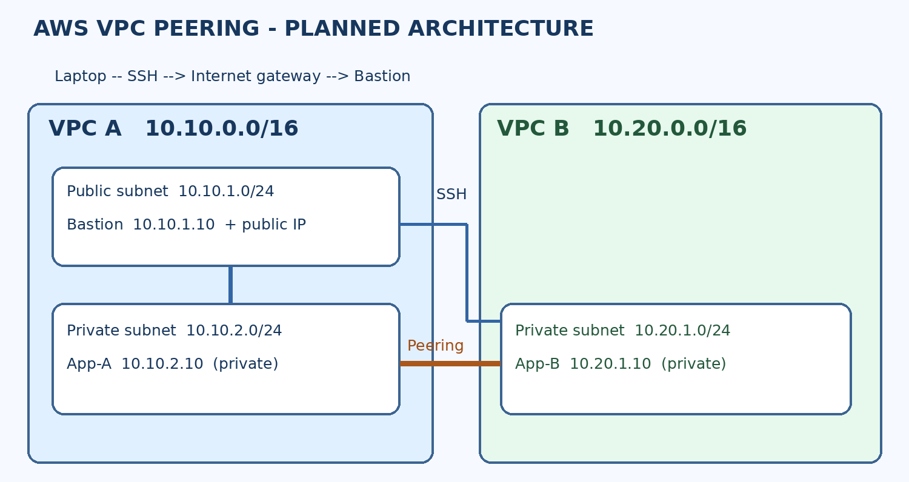

# AWS VPC Peering Project

## Objective
Create two non-overlapping VPCs in one AWS account and Region. Connect private application hosts using VPC peering, administer them through a public bastion, and verify both successful and intentionally blocked ICMP traffic.

## Architecture

| Component | Planned value |
|---|---|
| AWS Region | ap-south-1 (example; record actual Region) |
| VPC A | `ewb-vpc-a` — `10.10.0.0/16` |
| Public subnet A | `ewb-a-public` — `10.10.1.0/24` |
| Private subnet A | `ewb-a-private` — `10.10.2.0/24` |
| VPC B | `ewb-vpc-b` — `10.20.0.0/16` |
| Private subnet B | `ewb-b-private` — `10.20.1.0/24` |
| Bastion | `ewb-bastion` — `10.10.1.10` plus public IPv4 |
| Private App-A | `ewb-app-a` — `10.10.2.10`, no public IPv4 |
| Private App-B | `ewb-app-b` — `10.20.1.10`, no public IPv4 |

## Repository contents
- `Architecture/`: planned topology diagram.
- `Documentation/Implementation-Steps.md`: reproducible build, testing and cleanup instructions.
- `Screenshots/`: checklist; 
- `Project-Report/`: fill-in report PDF.

## Acceptance tests
1. App-A -> App-B ping fails before peering and routes.
2. Peering connection becomes `Active`; add bidirectional routes.
3. App-A -> App-B and App-B -> App-A private-IP pings succeed.
4. `ssh ewb-app-b` succeeds from laptop using bastion ProxyJump.
5. Remove App-B ICMP echo-request ingress temporarily: App-A ping fails; restore rule: ping recovers.
6. Confirm both application instances have **no public IPv4** and document cleanup.

## Security and cost
Restrict bastion SSH to your public `/32`. Never commit `.pem` keys, credentials or access tokens. EC2, EBS and public IPv4 can incur charges; there is no NAT gateway in this lab. Terminate lab resources after saving evidence.

## Attribution
Implementation plan based on the provided *EWB Courses AWS VPC Peering Student Project Workbook* (October 2026). Not affiliated with or endorsed by AWS.

